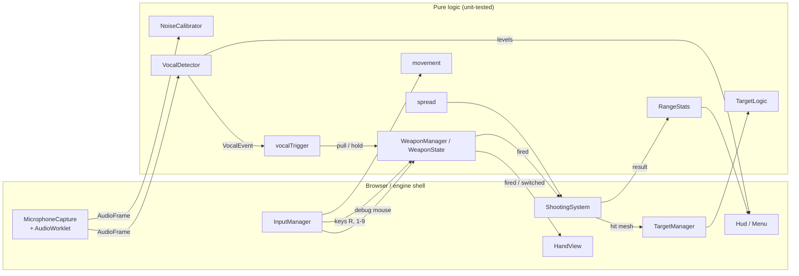
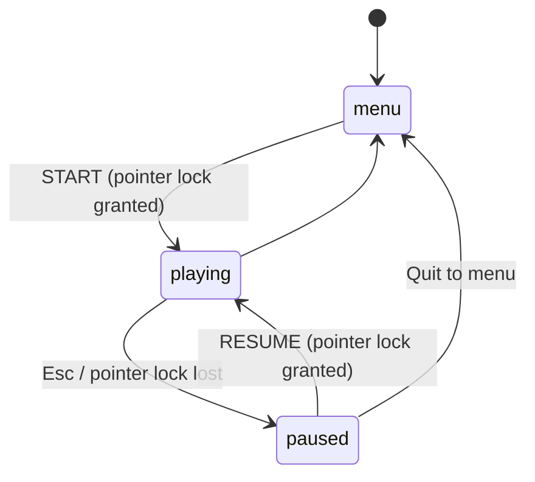
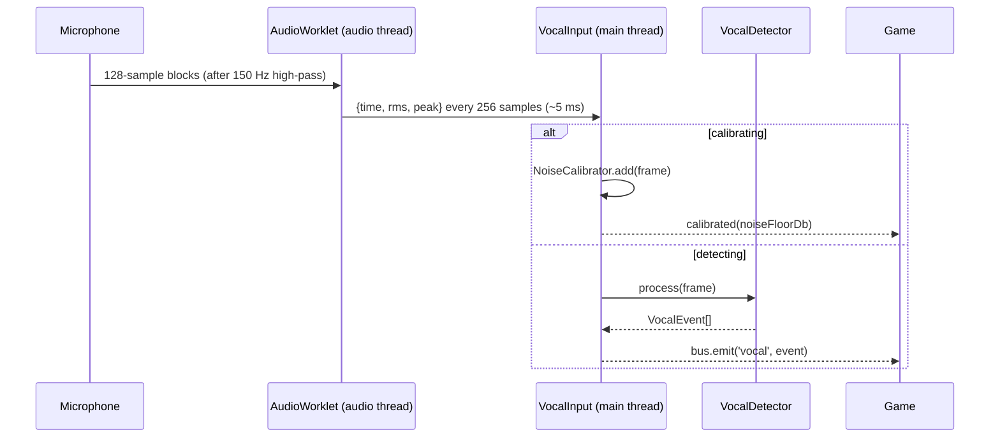
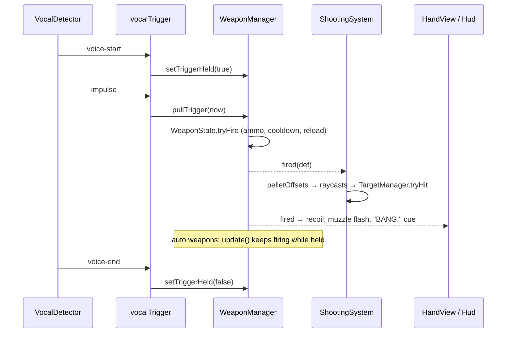

# Architecture

## Goals

- Keep the **audio detection replaceable**: weapons never see microphones.
- Keep **gameplay logic pure** (time and input injected) so it is testable today and can
  run on an authoritative server later.
- Keep the browser/engine layer **thin**.
- No premature infrastructure.

## Technology decisions (summary)

| Choice                   | Why                                                                           |
| ------------------------ | ----------------------------------------------------------------------------- |
| Vite 8                   | Fast dev server, native TS, bundles the AudioWorklet via `?worker&url`.       |
| TypeScript 6.0 (strict)  | Latest version supported by typescript-eslint (TS 7 not yet supported).       |
| Babylon.js 9             | Full-featured 3D engine with picking, cameras, lights; good TS types.         |
| Web Audio + AudioWorklet | Low-latency, local analysis on the audio thread.                              |
| Plain DOM UI (no React)  | The UI is a handful of panels; a framework adds weight with no clear benefit. |
| Vitest                   | Shares Vite config; fast.                                                     |

Details and alternatives: [DECISIONS.md](DECISIONS.md).

## Directory structure

```
index.html                 DOM shell: canvas, HUD, menu/settings overlay
src/
  main.ts                  Entry: WebGL check, creates Game
  core/
    Game.ts                Composition root, lifecycle, render loop, event wiring
    GameStateMachine.ts    menu ⇄ playing ⇄ paused
    EventBus.ts            Typed pub/sub
    math.ts                clamp/lerp/seeded RNG
  config/settings.ts       Settings schema, defaults, sanitize, localStorage persistence
  input/InputManager.ts    Keyboard, mouse deltas, Pointer Lock
  player/
    movement.ts            Pure move/look/bounds math
    PlayerController.ts    Applies movement to the Babylon camera
  audio/
    worklet/level-processor.ts  AudioWorklet: samples → {time, rms, peak} frames
    MicrophoneCapture.ts   getUserMedia, AudioContext, graph, devices
    microphoneErrors.ts    Error classification + user messages
    analysis.ts            dB, rms, peak, percentile (pure)
    NoiseCalibrator.ts     Ambient noise floor estimation (pure)
    VocalDetector.ts       Onset/sustain detection → VocalEvents (pure)
    VocalInput.ts          Facade: capture → calibrate | detect → EventBus
    types.ts               AudioFrame, VocalEvent
  weapons/
    weaponDefs.ts          Data-driven weapon definitions (incl. hand pose)
    WeaponState.ts         Ammo / cooldown / reload (pure)
    WeaponManager.ts       Arsenal, switching, trigger → shots (pure)
    vocalTrigger.ts        VocalEvent → trigger input (the only voice/weapon bridge)
  combat/
    spread.ts              Pellet cone sampling (pure)
    RangeStats.ts          Score keeping (pure)
    ShootingSystem.ts      Hitscan raycasts (Babylon)
    ImpactEffects.ts       Pooled impact puffs (Babylon)
  targets/
    layout.ts              Target placements (data)
    TargetLogic.ts         Knock-down state machine (pure)
    TargetManager.ts       Target meshes, hit routing, animation (Babylon)
  render/
    RangeEnvironment.ts    Low-poly range geometry and lights
    HandView.ts            First-person hands (view models), recoil, muzzle flash
    handAnimation.ts       Reload gesture keyframes + sampling (pure)
  ui/
    Hud.ts, Menu.ts, dom.ts, styles.css
```

## System responsibilities



`core/Game.ts` creates all of these and connects them. Nothing else knows the full graph.

## Game lifecycle



- The state changes on the `pointerlockchange` event, not on the button click, because the
  browser may refuse the lock (e.g. within ~1 s of pressing Esc in Chrome).
- One Babylon render loop runs in every state. Simulation (movement, weapon timers, HUD)
  advances only while `playing`. Targets and effects keep animating in the background.
- Vocal events are always detected. In the menu they light the “SAY BANG!” test lamp; while
  playing they drive weapons.

## Input flow

1. `InputManager` listens to DOM events. Keys only register while the pointer is locked.
2. Each frame, `PlayerController` consumes the accumulated mouse delta and the WASD intent,
   runs the pure `applyLook` / `computeMoveDelta` / `clampToBounds`, and writes the camera.
3. Discrete keys (`R`, `Digit1-9`) go through `onKeyPress` to `WeaponManager`.
4. The debug mouse trigger (dev builds or `?debug`, off by default) calls the same
   `pullTrigger` / `setTriggerHeld` API as the voice.

## Audio processing flow



Full detail: [AUDIO_SYSTEM.md](AUDIO_SYSTEM.md).

## Weapon event flow



Semi-automatic weapons ignore "held". Automatic weapons fire on each impulse **and** every
cooldown while held. An empty magazine emits `dry-fire` (“_click_”).

## Rendering notes

- Hand view models are parented to the camera and drawn in rendering group 1, so they never
  clip into walls.
- Hand poses are selected by `WeaponDef.viewModel` (`finger-gun`, `double-barrel`,
  `empty-hands`). Reload gestures are pure keyframe tracks (`handAnimation.ts`), unit-tested
  to start and end at the rest pose.
- Babylon is imported from the `@babylonjs/core` barrel. The bundle is ~7 MB (~1.6 MB
  gzip). Deep imports for tree-shaking are a known optimization (see ROADMAP M5).

## Future multiplayer considerations

- **What goes over the network:** trigger commands (`pull`, `hold on/off`, weapon switch,
  reload) plus player transforms. **Never audio for gameplay.** Detection stays on the
  client, which also keeps the privacy promise.
- `WeaponState` / `WeaponManager` / `TargetLogic` / `spread` already take `now` and an RNG,
  so the server can run the same code authoritatively (seeded RNG for pellets).
- `ShootingSystem` uses Babylon picking. A server would need a lightweight hit-test against
  simple colliders (or headless Babylon / a physics engine such as Rapier). Decide in M3.
- Latency: vocal detection adds ~5–15 ms on the client. Server reconciliation and lag
  compensation for hitscan will be the larger concern.
- Voice chat (WebRTC) would be a separate audio path from detection. Echo cancellation must
  be considered there, since detection deliberately turns it off.
